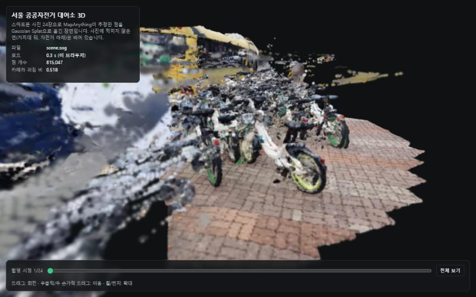
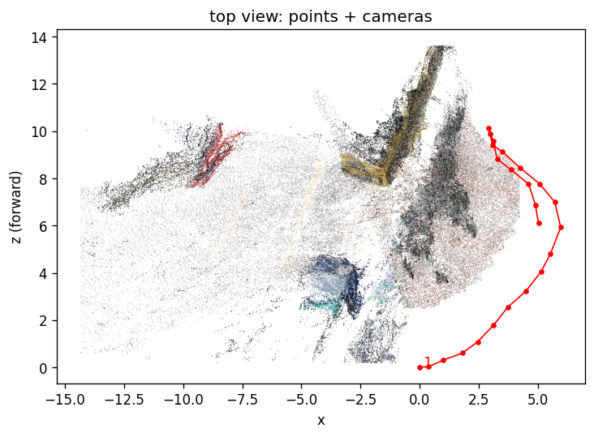

# 서울 공공자전거 대여소 3D 복원 (MapAnything → Gaussian Splat → Spark 뷰어)

스마트폰 영상에서 뽑은 사진 24장을 `facebook/map-anything-apache` 모델에 넣어 깊이, 점 좌표, 색, 카메라 위치를 추정합니다.
추정한 점을 Gaussian Splat으로 바꾼 뒤 three.js와 Spark로 브라우저에서 탐색합니다.

- **뷰어:** https://docie-rgb.github.io/bikeshare-station-3d/
- **장면 파일:** https://docie-rgb.github.io/bikeshare-station-3d/scene.sog



> **공개 판단:** 이 공간은 누구나 지나다니는 공공 보도 위의 서울시 공공자전거 대여소입니다. 사람, 차량 번호판, 스쿨버스의 학교명과 전화번호는 **복원 전에 블러**했고, 장면 파일과 뷰어에서 읽을 수 없음을 확인했습니다. 그래서 공개해도 된다고 판단했습니다(근거는 [8절](#8-공개-전-식별정보-검토)).

> **측정값 출처:** 아래 숫자는 모두 Colab T4에서 실행한 결과 파일(`results/metrics.json`, `results/formats.md`)과 브라우저에서 측정한 값입니다. 측정하지 않은 값(실제 거리, 복원 정확도 등)은 적지 않았습니다.

## 1. 환경

| 구분 | 사용 | 비고 |
|---|---|---|
| GPU 계산 | Google Colab, **T4 GPU** 런타임 | 노트북 `colab/bikeshare_mapanything.ipynb` |
| 복원 모델 | `facebook/map-anything-apache` (Apache-2.0) | GitHub `facebookresearch/map-anything`, 설치 시점 commit을 `metrics.json`에 기록 |
| 형식 변환 | `@playcanvas/splat-transform@3.10.3` | Node.js ≥ 22 필요 → Colab에 Node 22 설치 후 실행 |
| 뷰어 | three.js `0.180.0`, Spark `@sparkjsdev/spark@2.4.0` | jsDelivr CDN import map, 빌드 과정 없음 |
| 로컬 (Windows) | 정적 서버만 사용 (`python -m http.server`) | 기존 Python, Node 환경은 변경하지 않음. 로컬에는 Node가 없음 |

## 2. 작업 흐름

```
input/bikeshare_frames_24.zip
  └─(Colab) 압축 확인 → 식별정보 블러 → MapAnything 추론(긴 변 518, fp16)
       → mask 적용 → 축별 상·하위 0.5% 이상치 제외 → (필요 시) voxel 축소
       → 측정(metrics.json) → INRIA PLY(scene.ply)
       → splat-transform: scene.compressed.ply / scene.sog / scene.spz + formats.md
  └─(로컬) scene.sog + results/scene_meta.json → index.html 뷰어 → shots/viewer.png
  └─ GitHub Pages 게시 (공개 점검 후)
```

## 3. 입력 확인 (로컬에서 실제로 확인한 값)

- `input/bikeshare_frames_24.zip`: 10,027,717 B. 폴더 없이 루트에 `frame_001.jpg` ~ `frame_024.jpg` 24개가 들어 있습니다.
- 모든 이미지가 **720 × 1280 (세로)** JPEG이고, 파일 하나의 크기는 395–449 KB입니다.
- JPEG에 EXIF 블록이 없습니다. 따라서 GPS나 기기 정보도 없습니다.
- 모델 입력 크기: 긴 변 1280 → `LONG_SIDE = 518`로 축소합니다. 실제 입력 H×W는 `metrics.json`의 `model_input_hw`에 기록됩니다.

### 촬영 내용과 경로
- **원본 영상:** 과제 입력으로 받은 것은 영상에서 추출한 프레임 24장뿐이라, 영상 길이와 원본 해상도는 알 수 없습니다. 프레임은 720×1280 세로 화면입니다.
- **찍힌 부분 (프레임 순서):**
  1. 1–12번: 노란 스쿨버스 앞쪽 줄의 자전거
  2. 13–14번: 도로와 빨간 차
  3. 15–22번: 대여소 안내판과 파란 트럭 앞쪽 자전거
  4. 23–24번: 빨간 차와 버스 끝
  
  즉, 자전거 줄을 따라 보도 한쪽에서만 걸으며 찍었습니다.
- **추정 경로와 비교:** MapAnything이 추정한 카메라 24대도 이 순서대로 한 방향으로 휘어진 호를 그립니다(`results/preview_topdown.png`의 빨간 선, 경로 길이 19.73, 카메라 퍼짐 비 0.518).
  - 마지막 프레임에서 버스가 다시 보이는 것과 궤적 끝이 버스 쪽으로 돌아오는 것이 맞아떨어집니다.
  - 실제로 걸은 거리는 재지 않았으므로, 길이 자체가 맞는지는 확인하지 않았습니다.

## 4. 실행 방법

1. Colab에서 `colab/bikeshare_mapanything.ipynb`를 엽니다(파일 → 노트북 업로드). 런타임 유형은 **T4 GPU**로 설정합니다.
2. 위에서부터 순서대로 실행합니다. 2단계에서 `bikeshare_frames_24.zip`을 업로드합니다.
3. 3단계의 `redaction_sheet.jpg`를 보고 블러가 빠진 곳이 없는지 확인합니다.
4. 마지막 셀이 `bikeshare_results.zip`을 내려받습니다. 압축을 풀어 내용을 이 저장소의 `results/`에 넣고, `scene.sog`는 저장소 루트로 복사합니다.
5. 로컬에서 확인합니다.
   ```bash
   python -m http.server 8765
   ```
   그다음 `http://localhost:8765/`를 엽니다.

노트북은 `python scripts/build_notebook.py`로 다시 만들 수 있습니다. 이 스크립트가 `scripts/`의 코드와 `privacy/redact_boxes.json`을 노트북 안에 넣습니다.

## 5. 측정 정의

| 항목 | 정의 | 저장 위치 |
|---|---|---|
| 카메라 위치 | MapAnything `camera_poses`(OpenCV cam2world)의 평행이동 성분 24개 | `metrics.json → camera_positions` |
| 장면 크기 | 최종 점들의 축 정렬 bbox 크기(extent)와 대각선. 단위는 MapAnything 메트릭 스케일 추정값(미터 근사, 실측 대조 안 함) | `scene_bbox` |
| 점 개수 | mask 통과 → 0.5% 제외 후 → 최종(voxel 후) 단계별 | `points` |
| 카메라 퍼짐 비 | (카메라 위치 bbox 대각선) ÷ (장면 bbox 대각선) | `spread_ratio` |
| 시간 | 모델 로드, 이미지 로드, 추론, PLY 저장의 wall-clock | `timings_s`, `peak_gpu_mem_gib` |

## 6. 결과 (Colab T4 실측)

### 실행 환경
| 항목 | 값 |
|---|---|
| GPU / PyTorch | Tesla T4 (15 GB) / `2.14.1+cu130` |
| MapAnything commit | `3d10cf7a3016fc0f9bb13a071ee66c47b10be0d9` |
| 입력 → 모델 입력 크기 | 720×1280 → **294×518** (W×H, 긴 변 518), fp16 AMP |

### 시간과 메모리
| 단계 | 값 |
|---|---:|
| 모델 로드 (첫 실행, 가중치 다운로드 포함) | 112.96 s |
| 이미지 로드 + 전처리 (24장) | 0.98 s |
| **추론 (24장, `minibatch_size=1`)** | **10.62 s** |
| INRIA PLY 저장 | 0.13 s |
| 최대 GPU 메모리 (`max_memory_allocated`) | 6.28 GiB |

### 점 개수
| 단계 | 점 개수 | 비고 |
|---|---:|---|
| 전체 픽셀 (24 × 294 × 518) | 3,655,008 | |
| mask 통과 | 3,030,809 | 82.9%. 시점별 112,206–139,100개 |
| 축별 상·하위 0.5% 제외 후 | 2,959,480 | 71,329개(2.35%) 제외 |
| **최종 (voxel 축소)** | **815,047** | voxel 0.0226 (`MAX_POINTS = 1,000,000` 이하가 되도록 자동 결정) |

0.5% 제외 구간은 x [−14.35, 4.22], y [−5.05, 1.15], z [0.19, 13.62]입니다.

### 장면 크기와 카메라
| 항목 | 값 |
|---|---|
| 장면 bbox 크기 (x, y, z) | 18.57 × 6.20 × 13.43, 대각선 **23.74** |
| 카메라 위치 bbox 크기 (x, y, z) | 5.97 × 3.60 × 10.13, 대각선 12.30 |
| 카메라 이동 경로 길이 (1→24번) | 19.73 |
| 카메라 중심으로부터 평균 거리 | 3.75 |
| **카메라 퍼짐 비** | **0.518** |

- 단위는 MapAnything의 메트릭 스케일 추정값입니다(미터 근사). 실제 자전거 길이 같은 기준과 비교하지 **않았으므로** 절대 크기의 정확도는 확인되지 않았습니다.
- 축은 중력 방향 기준이 아닙니다. world 좌표는 MapAnything 출력 좌표계(OpenCV 규약)를 그대로 쓴 것이라서, y축 크기를 "높이"로 읽으면 안 됩니다.
  예를 들어 손으로 들고 찍은 카메라의 y 범위가 3.60으로 나온 것은 축이 기울어진 영향으로 보입니다. 카메라가 실제로 3.6 m를 오르내리지는 않았을 것입니다.
- 24개 카메라 위치는 `metrics.json → camera_positions`에 있습니다. 위에서 본 분포는 `results/preview_topdown.png`에 있습니다.



### 형식 비교 (splat-transform 3.10.3, Colab, Node 22)
| 형식 | 파일 | 크기 (MB) | 원본 대비 | 변환 시간 (s) | 점 개수 | 점당 바이트 |
|---|---|---:|---:|---:|---:|---:|
| INRIA ply (입력) | `scene.ply` | 55.42 | 100% | - | 815,047 | 68.00 |
| compressed.ply | `scene.compressed.ply` | 13.27 | 23.9% | 2.37 | 815,047 | 16.28 |
| **sog** | `scene.sog` | **4.94** | **8.9%** | 10.12 | 815,047 | **6.06** |
| spz | `scene.spz` | 7.47 | 13.5% | 2.34 | 815,047 | 9.17 |

- 점 개수는 각 출력 파일을 splat-transform으로 다시 PLY로 바꿔(round-trip) 센 값입니다. 세 형식 모두 점이 빠지지 않았습니다.
- 변환 시간에는 Node 프로세스 시작 시간이 포함됩니다. npx 다운로드 시간은 미리 캐시를 채워서 측정에서 뺐습니다.
- SOG 변환은 첫 시도에 성공했습니다(`-g cpu`로 다시 시도하지 않음). 시간은 다른 두 형식의 약 4배입니다.
### 같은 시점 화면 비교와 형식 선택
뷰어의 **파일 끌어다 놓기** 기능(`fileBytes` + `fileType`)으로 네 파일을 차례로 열었습니다. 카메라는 그대로 둔 채 장면만 바꿨습니다.

| 파일 | Spark `fileType` | 뷰어가 센 알갱이 수 | 불러오기 (s, 로컬) |
|---|---|---:|---:|
| `scene.ply` | `ply` | 815,047 | 0.28 |
| `scene.compressed.ply` | `ply` | 815,047 | 0.21 |
| `scene.sog` | `pcsogszip` | 815,047 | 0.24 |
| `scene.spz` | `spz` | 815,047 | 0.37 |

- **열림:** 네 파일 모두 오류 없이 열렸고, 알갱이 수도 변환 측정값과 같았습니다.
- **화면 차이:** 시점 1에서 1280×800 화면을 비교했습니다. 자전거 바퀴의 연두색 테, 바구니, 바닥 블록 경계 같은 모서리와 작은 물체에서 형식 간 차이가 **눈으로는 보이지 않았습니다.**
  - 픽셀 차이를 수치로 재 보려고 했지만, 같은 파일을 다시 찍은 화면끼리도 차이가 크게 나왔습니다. 캡처 시점이 일정하지 않았기 때문이라 그 수치는 쓰지 않았습니다.
- **선택 이유:** 화면 차이는 보이지 않았고, `scene.sog`가 가장 작습니다(4.94 MB, 원본의 약 1/11). 폰에서 내려받는 시간을 줄이려고 게시 파일로 골랐습니다.
- 확장자와 Spark 형식 이름의 대응은 `index.html`의 `EXT_TO_TYPE`에 있습니다. `.compressed.ply`와 `.ply`는 모두 `ply`로 열고, Spark가 헤더를 보고 압축 여부를 판별합니다. `.sog`는 `pcsogszip`로 엽니다.

### 첫 화면까지 걸린 시간
뷰어 정보 패널의 **"첫 화면까지"** 값은 페이지를 연 순간부터 캔버스에 장면 픽셀이 처음 나타날 때까지의 시간입니다(`performance.now()` 기준).

| 기기 | 브라우저 · 통신 | 첫 화면까지 |
|---|---|---:|
| Windows PC (Claude 앱 내장 브라우저) | 로컬 서버 (네트워크 없음) | 2.80–4.24 s |
| Windows PC (Claude 앱 내장 브라우저) | GitHub Pages | 배포 후 측정 |
| 내 폰 | (기기 · Wi-Fi/LTE 기재) | 직접 측정해 기재 |
| 다른 사람 폰 | (기기 · Wi-Fi/LTE 기재) | 직접 측정해 기재 |

폰 값은 실제 폰으로 주소를 열어 패널에 표시된 숫자를 적어야 하므로, 측정 전에는 비워 둡니다.

## 7. 복원되지 않은 부분과 원인

뷰어에서 촬영 시점 1, 9, 17과 전체 보기를 직접 확인했습니다. 아래 내용은 그때 관찰한 것과, 원인으로 추정되는 것을 구분해 적었습니다.
정량적인 복원 정확도(실측 거리와 비교한 오차 등)는 기준값이 없어서 **측정하지 않았습니다.**

| 관찰 | 위치 | 원인 (추정) |
|---|---|---|
| 거치대·자전거 뒤쪽, 자전거 아래, 버스와 트럭 반대편이 비어 있음. 전체 보기에서 장면이 한쪽 면만 있는 "껍데기" 모양 | 전체 | 카메라가 보도 한쪽에서 호를 그리며 움직였고(퍼짐 비 0.518, `preview_topdown.png`의 빨간 궤적), 반대편에서는 찍지 않았습니다. 관측되지 않은 면은 만들어 낼 수 없습니다. |
| 가까운 자전거들이 겹쳐 뭉개짐. 바구니와 안장이 두 겹처럼 보임 | 트럭 쪽 근경 (시점 17에서 확인) | 같은 모양의 자전거가 반복되어 시점마다 깊이가 조금씩 다르게 추정되었고, 그 점들이 그대로 겹쳤습니다(학습·융합 단계 없음). 이 구간(14–22번)은 mask를 통과한 점도 112k–119k로 1–13번(126k–139k)보다 적습니다. |
| 바퀴살, 바구니 철망, 브레이크 선이 사라지고 바퀴는 고리 모양 색 띠로만 남음 | 모든 자전거 | 모델 입력이 294×518로 줄면서 이런 구조가 1 px보다 가늘어졌고, `mask_edges`가 깊이 경계의 점을 지웠습니다. |
| 버스 옆면과 먼 도로·차량이 길게 늘어진 줄무늬처럼 보임 | 장면 가장자리 (버스, 원경 도로) | 멀리 있는 면은 픽셀 하나가 덮는 3D 크기가 커서 깊이 오차가 큽니다. 버스는 1–12번에서만 보이고, 차량과 보행자는 프레임마다 위치가 다를 수 있습니다. |
| 바닥 가장자리가 톱니 모양으로 끊김 | 보도블록 바깥 경계 | 좌표축별 0.5% 제외(전체의 2.35%)와 각 사진 시야의 경계가 그대로 드러났습니다. |
| 번호판, 버스 문구, 안내판 부분 색이 뭉개짐 | 버스 측면, 트럭 전면 | 의도한 처리입니다. 복원 전에 블러를 적용했습니다. |
| 가까이 다가가면 둥근 점 무늬가 보이고 표면이 거침 | 근접 시 | 3DGS 학습 없이 점마다 등방성 가우시안 하나를 두었고, 크기는 픽셀 하나의 3D 크기(최소 voxel/2)로 정했습니다. |

### 검은 얼룩과 구멍: 시차와 정렬로 본 원인
- **검은 얼룩 = 알갱이가 없는 자리:** 뷰어 배경색(검정)이 그대로 비쳐 보이는 곳입니다. 자전거 사이, 거치대 뒤, 장면 바깥쪽에 생깁니다.
  이 방법은 각 사진 픽셀을 3D로 옮겨 알갱이를 만들기 때문에, **어느 사진에도 보이지 않은 면은 알갱이가 0개**입니다. 앞 자전거에 가려진 뒤 자전거의 아랫부분과 거치대 뒷면이 그런 자리입니다.
- **시차(parallax)가 작은 곳은 깊이가 흔들립니다:** 카메라 위치 범위(대각선 12.30)가 장면 크기(23.74)의 절반 정도이고(퍼짐 비 0.518), 모두 보도 한쪽에 몰려 있습니다.
  - 가까운 자전거는 시점이 바뀔 때 많이 움직여 보여(시차가 큼) 위치가 비교적 잘 잡힙니다.
  - 먼 버스, 도로, 차량은 시점이 바뀌어도 거의 움직이지 않아(시차가 작음) 시선 방향의 깊이가 불확실합니다. 그래서 시선 방향으로 늘어진 줄무늬가 되고, 그 사이에 빈틈(검은 띠)이 생깁니다.
- **정렬(alignment)이 어긋난 곳은 겹칩니다:** 시점마다 깊이 지도를 따로 예측하고 추정한 카메라 위치로 이어 붙였습니다.
  - 카메라 위치나 깊이가 조금이라도 다르면 같은 자전거가 두 겹으로 놓입니다.
  - 자전거처럼 모양이 반복되는 물체는 다른 자전거와 대응이 헷갈리기 쉬워서, 트럭 쪽 근경(14–22번)에서 이 현상이 가장 심합니다. 검은 타이어와 안장이 겹쳐 짙은 얼룩처럼 보입니다.
- **잘 보이는 방향과 안 보이는 방향:**
  - 잘 보이는 방향: 촬영한 쪽(보도에서 버스·트럭을 바라보는 방향, 시점 1–12와 23–24 부근)에서 보면 바닥 블록, 자전거 앞줄, 버스가 그럴듯하게 보입니다.
  - 안 보이는 방향: 반대편(버스 쪽에서 보도를 바라보는 방향)이나 위에서 내려다보면 위의 빈자리와 겹침이 모두 드러납니다. 원본 프레임에도 그 방향을 찍은 사진은 한 장도 없습니다.

개선 방향: 거치대 반대편과 위쪽에서 추가 촬영, 원본 해상도에 가까운 입력(메모리 허용 범위), 이 점들을 초기값으로 한 3DGS 학습(예: gsplat) 적용.

## 8. 공개 전 식별정보 검토

24장을 모두 직접 확인했습니다. 블러 영역은 `privacy/redact_boxes.json`에 있으며, 상자는 모두 53개입니다(문구 20, 사람 12, 번호판 12, 전화번호 9).
`privacy/review.html`(로컬 전용)로 상자 위치를 원본 위에 겹쳐 확인했습니다.

| 종류 | 프레임 | 처리 |
|---|---|---|
| 차량 번호판 (판독 가능) | 버스 후면 2–4번, 트럭 전면 15–16, 19–22번 | 복원 전 모자이크 + 블러 |
| 학교명, 캠퍼스명, 전화번호, 웹주소 (스쿨버스 측면) | 1–12번 | 복원 전 모자이크 + 블러 |
| 보행자, 이륜차 운전자 (원거리, 얼굴 판별 불가 수준) | 1, 4, 5, 13, 14, 16–19번 | 복원 전 모자이크 + 블러 (불확실한 것도 포함) |
| 노점 손글씨 안내판, 상가 간판 | 15–22번 | 블러 (위험 낮음, 보수적으로 처리) |
| 공공자전거 차대 번호 | 12–24번 | 공공 자산 번호라서 처리하지 않음 |

공개 원칙:
- 원본 사진, ZIP, 블러하지 않은 복원 결과는 저장소에 올리지 않습니다(`.gitignore`).
- 게시하는 `scene.sog`는 반드시 `REDACT = True`로 만든 결과여야 합니다. `metrics.json`의 `"redacted": true`로 확인합니다.
- 블러 상자는 사람이 눈으로 정했습니다. Colab의 `redaction_sheet.jpg`와 뷰어에서 **다시 한 번 확인한 뒤에** 게시합니다.

게시 전 최종 점검 결과(2026-11-13):
- **최종 뷰어 확인:**
  - 시점 3, 7에서 버스 측면과 후면을, 시점 16, 19에서 트럭 전면을 확인했습니다. 학교명, 전화번호, 번호판 글자는 읽을 수 없는 뭉개진 색 덩어리로만 남았습니다.
  - 장면 색은 블러한 사진에서만 가져오므로, 블러 전보다 더 자세한 정보는 담길 수 없습니다.
- **저장소 파일:**
  - 원본 JPEG, 입력 ZIP, 결과 ZIP, `scene.ply`, `scene.compressed.ply`, `scene.spz`, 로컬 설정(`.claude/`)은 `.gitignore`로 제외했습니다.
  - 공개 파일에서 로컬 경로, 계정 이름, 이메일, 키·토큰, 번호판과 전화번호 문자열을 검색했고, 걸린 것은 없었습니다. `privacy/redact_boxes.json`의 메모에도 번호 자체는 적지 않았습니다.
  - 커밋 작성자 이메일은 GitHub noreply 주소를 씁니다.

## 9. 파일 구성

| 경로 | 내용 |
|---|---|
| `index.html` | 뷰어 (기본 `scene.sog` + `results/scene_meta.json`, `?src=` / `?meta=`로 다른 파일 지정, 파일 끌어다 놓기·열기로 형식 비교) |
| `scene.sog` | 게시용 경량 장면 (4.94 MB, 815,047점, 블러 입력으로 복원) |
| `colab/bikeshare_mapanything.ipynb` | 복원, 측정, 변환 전체 노트북 |
| `scripts/splat_utils.py` | 이상치 제외, 측정, INRIA PLY 저장 |
| `scripts/convert_formats.py` | splat-transform 변환과 크기, 시간, 점 개수 측정 |
| `scripts/build_notebook.py` | 노트북 생성기 |
| `scripts/test_synthetic.py` | 합성 장면으로 유틸리티와 뷰어 확인 (실제 결과 아님) |
| `privacy/redact_boxes.json`, `privacy/review.html` | 블러 영역과 로컬 검토 페이지 |
| `results/` | `metrics.json`, `scene_meta.json`, `formats.json`/`.md`, `preview_topdown.png`, `redaction_sheet.jpg` (블러 후 썸네일) |
| `shots/viewer.png` | 뷰어 화면 캡처 (촬영 시점 1, 1280×800 화면을 800×499로 저장) |

`scene.ply`, `scene.compressed.ply`, `scene.spz`, 결과 ZIP은 용량 때문에 `.gitignore`로 제외했습니다. 형식 비교 수치는 위 표와 `results/formats.json`에 남아 있습니다.
